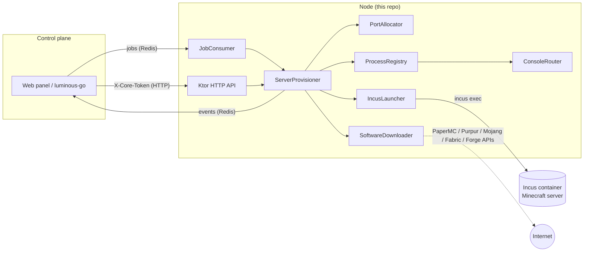
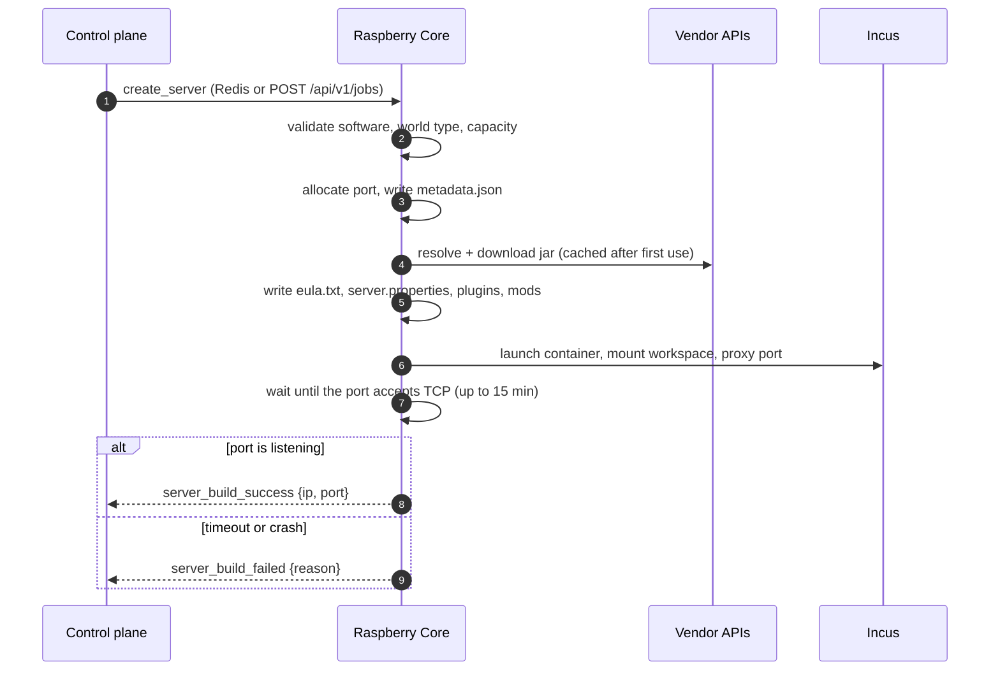

<div align="center">



<br/>

[](https://github.com/omslx/Raspberry/actions/workflows/ci.yml)
[](LICENSE)
[](https://github.com/omslx/Raspberry/stargazers)
[](https://github.com/omslx/Raspberry/forks)
[](https://github.com/omslx/Raspberry/issues)
[](https://github.com/omslx/Raspberry/commits/master)


**[Overview](#overview) · [Architecture](#architecture) · [Quick start](#quick-start) · [Configuration](#configuration) · [HTTP API](#http-api) · [Redis contract](#redis-contract) · [Project structure](#project-structure) · [Contributing](#contributing)**

</div>


## Overview

**Raspberry Core** is the node agent of a Minecraft hosting platform. It runs on a physical or virtual machine ("node"), receives *create* and *power* jobs from the control plane, and turns them into running game servers:

- downloads the requested server software from the official vendor APIs and caches it,
- allocates a port and builds an isolated workspace (`eula.txt`, `server.properties`, plugins, mods, logs),
- starts the server inside its own **unprivileged Incus container**,
- reports the outcome back as events, and keeps managing the server afterwards (power, console, files, backups).

It is one half of a larger system: the control plane (web panel and the `luminous-go` service) talks to this agent either through **Redis pub/sub** or through its **authenticated HTTP API**.

| | |
|---|---|
| **Language / runtime** | Kotlin 2.3 on JDK 23 (Gradle toolchain) |
| **HTTP** | Ktor 3 on Netty, default port `8081` |
| **Messaging** | Redis pub/sub via Jedis |
| **Isolation** | Incus containers, `security.idmap.isolated`, never privileged |
| **Server software** | Paper, Purpur, Vanilla, Fabric, Forge |
| **State** | Plain files: `./servers`, `./state/ports.json`, `./versions`, `./cache`, `./backups` |
| **License** | GPL-3.0 |


## Architecture




### What happens on `create_server`



Key design points:

- **Idempotent creates.** A `create_server` for a known `request_id` returns the existing state instead of building a duplicate.
- **Success means reachable.** `server_build_success` is published only after the allocated port actually accepts connections.
- **Restart-safe.** On boot the core recovers workspaces from disk, marks servers whose port is still listening as `running`, and re-registers Incus containers named `luminous-srv-*`.
- **Sequential worker.** Redis jobs are processed one at a time; downloads are throttled by `download.max_concurrent`.
- **Containers are kept.** Stopping a server force-stops its container but never deletes it or its workspace.


## Quick start


### Prerequisites

| Requirement | Notes |
|---|---|
| JDK 23 | Gradle's toolchain resolver can download it automatically |
| Redis | Reachable from the node (default `localhost:6379`) |
| Incus | Required when `runtime.mode = "incus"` (the default); the configured image must ship a JRE 21+ |
| `ss` (Linux) | Used to find orphaned server processes |

### Build and run

```bash
git clone https://github.com/omslx/Raspberry.git
cd Raspberry

./gradlew run          # Windows: gradlew.bat run
```

On the first start the core writes a default `config.toml` next to the working directory. Edit it, **set a real token**, and start again.

```bash
export LUMINOUS_CORE_TOKEN="a-long-random-secret"   # overrides config.toml
./gradlew run
```

### Local development without Incus

```toml
[runtime]
mode = "process"   # runs `java` directly on the host
```

### Verify it is alive

```bash
curl http://localhost:8081/v1/health/live
curl http://localhost:8081/v1/health/ready
```

### Tests

```bash
./gradlew test
```


## Configuration

All settings live in `config.toml` (created on first start).

| Section | Key | Default | Description |
|---|---|---|---|
| `[node]` | `name` | `node-1` | Node identity shown to the panel |
| | `public_host` | `127.0.0.1` | IP/hostname returned in `server_build_success` |
| | `start_port` / `end_port` | `25565` / `26000` | Port range for game servers |
| | `max_servers` | `10` | Concurrent provisioning + running servers |
| `[runtime]` | `mode` | `incus` | `incus` (product default) or `process` (dev) |
| `[incus]` | `image` | `images:ubuntu/24.04/cloud` | Container image; must ship JRE 21+ |
| | `remote` | `local` | Incus remote |
| | `idmap_isolated` | `true` | Unprivileged containers only |
| | `runtime_version` | `1` | Stamped as `user.luminous.runtime_version` |
| `[api]` | `core_token` | `change-me-core-admin-token` | API secret (prefer the env var below) |
| | `admin_token` | – | Legacy alias of `core_token` |
| | `http_port` | `8081` | HTTP API port |
| | `max_upload_mb` | `200` | Upload and file-edit size cap |
| `[download]` | `auto_download` | `true` | Fetch missing jars automatically |
| | `max_concurrent` | `3` | Parallel downloads |
| `[paths]` | `versions_dir` | `./versions` | Cache of downloaded server jars |
| `[redis]` | `address` / `port` | `localhost` / `6379` | Redis endpoint |
| | `jobs_channel` | `luminous:core:jobs` | Canonical jobs channel |
| | `events_channel` | `luminous:core:events` | Canonical events channel |
| | `channel` | `raspberry` | Legacy channel (still consumed) |
| `[discord]` | `token`, `guildID`, … | – | Alert helper, currently not wired in |

**Token resolution order:** env `LUMINOUS_CORE_TOKEN` → `[api].core_token` → `[api].admin_token` → built-in dev default (logs a loud warning).

**Jar cache.** Server jars are cached in `versions/<software>/<version>.jar` and never downloaded twice. Vanilla bootstrap jars can be pre-seeded as `cache/mojang_<version>.jar`, which is useful on slow or restricted networks. Details in [CACHE.md](CACHE.md).


## HTTP API


Base URL: `http://<node>:8081`. Everything under `/api/v1` requires the header:

```text
X-Core-Token: <token>        # legacy alias: X-Admin-Token
```

Health endpoints are public. Errors are JSON: `{"error": "..."}`.

### Endpoints

| Method | Path | Description |
|---|---|---|
| `GET` | `/v1/health/live` | Liveness probe |
| `GET` | `/v1/health/ready` | Readiness: Redis, workspace, Incus, memory, disk, CPU |
| `GET` | `/healthz` | Legacy health summary |
| `POST` | `/api/v1/jobs` | Submit a `create_server` or `power_server` job |
| `GET` | `/api/v1/servers` | Node snapshot with all servers |
| `GET` | `/api/v1/servers/{id}` | One server's status |
| `POST` | `/api/v1/servers/{id}/power` | `{"action": "start\|stop\|restart"}` |
| `GET` | `/api/v1/servers/{id}/console?lines=100` | Recent console lines |
| `POST` | `/api/v1/servers/{id}/console` | `{"command": "say hi"}` |
| `GET` | `/api/v1/servers/{id}/files?subdir=plugins` | List files (`plugins`, `mods`, `root`, or `all` for a recursive tree) |
| `POST` | `/api/v1/servers/{id}/files` | Multipart upload: `subdir`, `path`, `file` |
| `PUT` | `/api/v1/servers/{id}/files?subdir=&name=` | Replace a text file (body = content) |
| `DELETE` | `/api/v1/servers/{id}/files?subdir=&name=` | Delete a file |
| `GET` | `/api/v1/servers/{id}/files/download?subdir=&name=` | Download a file |
| `POST` | `/api/v1/servers/{id}/backup` | Zip the workspace into `./backups` |
| `GET` | `/api/v1/servers/{id}/backup` | List backups |

Per-IP rate limits (per minute): jobs **30**, console commands **30**, uploads **10**. Exceeding a limit returns `429` with `Retry-After`.

### Examples

```bash
export CORE=http://localhost:8081
export TOKEN=a-long-random-secret

# Create a server (returns 202 Accepted; completion arrives as an event)
curl -X POST "$CORE/api/v1/jobs" \
  -H "X-Core-Token: $TOKEN" -H "Content-Type: application/json" \
  -d '{
        "type": "create_server",
        "request_id": "srv-001",
        "player_name": "Steve",
        "settings": {
          "software": "paper",
          "version": "1.21.4",
          "memory_mb": 2048,
          "max_players": 20,
          "motd": "Hello from Raspberry",
          "online_mode": false,
          "plugins": [{ "name": "ExamplePlugin", "url": "https://example.com/plugin.jar" }]
        }
      }'

# Poll the status
curl -H "X-Core-Token: $TOKEN" "$CORE/api/v1/servers/srv-001"

# Stop it
curl -X POST "$CORE/api/v1/servers/srv-001/power" \
  -H "X-Core-Token: $TOKEN" -H "Content-Type: application/json" \
  -d '{"action":"stop"}'

# Send a console command
curl -X POST "$CORE/api/v1/servers/srv-001/console" \
  -H "X-Core-Token: $TOKEN" -H "Content-Type: application/json" \
  -d '{"command":"say Maintenance in 5 minutes"}'

# Upload a plugin
curl -X POST "$CORE/api/v1/servers/srv-001/files" \
  -H "X-Core-Token: $TOKEN" \
  -F subdir=plugins -F path=MyPlugin.jar -F file=@MyPlugin.jar
```

### Server settings

All keys are optional.

| Key | Default | Notes |
|---|---|---|
| `software` | `paper` | `paper`, `purpur`, `vanilla`, `fabric`, `forge` |
| `version` | `1.21` | Minecraft version |
| `world_type` | `default` | `default`, `flat`, `amplified` |
| `memory_mb` | `2048` | Clamped to 512–65536; legacy `ram_mb` is accepted |
| `max_players` | `20` | Clamped to 2–100000 |
| `motd` | `A Luminous Server` | |
| `hardcore` | `false` | |
| `online_mode` | `false` | |
| `plugins`, `mods` | `[]` | List of `{name, url}`; downloaded into the workspace |

Server status values: `provisioning` → `running` → `stopped`, or `failed`.

### Safety guards

- **Files:** only `plugins`, `mods` and `root` are addressable; paths are normalized against traversal; extensions are whitelisted; `eula.txt`, `server.properties` and `metadata.json` are protected; edits are written atomically.
- **Console:** control characters and shell metacharacters are rejected, and `stop` is reserved for the power API.
- **Auth:** tokens are compared in constant time over SHA-256 digests.


## Redis contract

Jobs arrive on `luminous:core:jobs` (the legacy `raspberry` channel is still consumed for job messages). Events are published on `luminous:core:events`.

**Jobs (in)**

```json
{ "type": "create_server", "request_id": "srv-001", "player_uuid": "...", "player_name": "...", "settings": { } }
{ "type": "power_server",  "server_id": "srv-001", "action": "start" }
```

**Events (out)**

```json
{ "type": "server_build_success", "request_id": "srv-001", "ip": "203.0.113.10", "port": 25570 }
{ "type": "server_build_failed",  "request_id": "srv-001", "reason": "..." }
{ "type": "server_power_success", "server_id": "srv-001", "action": "start" }
```

Try it from the shell:

```bash
redis-cli PUBLISH luminous:core:jobs '{"type":"power_server","server_id":"srv-001","action":"restart"}'
redis-cli SUBSCRIBE luminous:core:events
```


## Project structure

This block is regenerated automatically on every push by [`update_tree.py`](.github/scripts/update_tree.py) through a GitHub Action, so it always matches the repository.

<!-- TREE:START -->
```text
Raspberry/                                 # Repository root
├── cache/                                 # Shared vanilla-jar cache (see CACHE.md)
├── src/
│   ├── main/
│   │   └── kotlin/                        # Application sources
│   │       ├── api/
│   │       │   ├── CoreToken.kt           # X-Core-Token resolution + constant-time compare
│   │       │   ├── RateLimiter.kt         # Fixed-window per-IP limiter (jobs / console / files)
│   │       │   └── routing.kt             # HTTP API: health, jobs, console, power, files, backups
│   │       ├── config/
│   │       │   ├── ConfigMain.kt          # Typed config model (AppConfig and sections)
│   │       │   └── DefaultConfig.kt       # Default config.toml written on first start
│   │       ├── discord/
│   │       │   └── DiscordAlert.kt        # Discord embed alert helper (currently unused)
│   │       ├── incus/
│   │       │   ├── IncusCli.kt            # Thin wrapper around the `incus` CLI
│   │       │   └── IncusLauncher.kt       # Runs each server in its own unprivileged container
│   │       ├── job/
│   │       │   ├── JobConsumer.kt         # Redis subscriber with reconnect/backoff
│   │       │   └── JobModels.kt           # Job contract: settings, parser, supported software
│   │       ├── managers/
│   │       │   ├── ConfigManager.kt       # Loads/creates config.toml
│   │       │   ├── CoreRuntime.kt         # Singletons, startup, state reconciliation
│   │       │   └── RedisManager.kt        # Wires publisher, events and job consumer
│   │       ├── redis/
│   │       │   ├── EventPublisher.kt      # server_build_* / server_power_* events
│   │       │   ├── RedisGetter.kt         # Pub/Sub subscriber callbacks
│   │       │   └── RedisPublisher.kt      # Fire-and-forget Redis publisher
│   │       ├── server/
│   │       │   ├── ConsoleRouter.kt       # Log tailer: ring buffer + online-player tracking
│   │       │   ├── ForgeInstaller.kt      # One-time Forge --installServer + JVM args
│   │       │   ├── PortAllocator.kt       # Persistent random port allocation
│   │       │   ├── ProcessLauncher.kt     # Dev runtime: plain `java` on the host
│   │       │   ├── ProcessRegistry.kt     # Tracks servers, status, metadata, recovery
│   │       │   ├── SafePaths.kt           # Path-traversal / extension / subdir guards
│   │       │   ├── ServerLauncher.kt      # Runtime abstraction (incus | process)
│   │       │   ├── ServerProvisioner.kt   # create / power pipeline end to end
│   │       │   └── SoftwareDownloader.kt  # Resolves + caches jars from official APIs
│   │       ├── utils/
│   │       │   ├── CreateDirectory.kt     # mkdir -p + touch helper
│   │       │   ├── Logger.kt              # Timestamped console + file logger
│   │       │   └── stats.kt               # Status enum
│   │       └── Main.kt                    # Entry point: loads config, boots Ktor/Netty
│   └── test/
│       └── kotlin/                        # Unit tests (JUnit 5)
│           ├── api/
│           │   └── CoreTokenP0Test.kt
│           ├── config/
│           │   └── ConfigTest.kt
│           ├── incus/
│           │   ├── IncusCliTest.kt
│           │   ├── IncusLauncherTest.kt
│           │   └── IncusP0Test.kt
│           ├── job/
│           │   └── JobModelsP0Test.kt
│           └── server/
│               ├── SafePathsP1Test.kt
│               └── SafePathsTest.kt
├── build.gradle.kts                       # Gradle build (Kotlin 2.3, Ktor 3, Jedis, JDA)
├── CACHE.md                               # How the shared server-jar cache works
├── gradle.properties                      # Gradle properties
├── LICENSE                                # GPL-3.0
└── settings.gradle.kts                    # Project name + toolchain resolver
```
<!-- TREE:END -->


## Known limitations

- Redis authentication is not supported yet (`password` is not wired in).
- Jobs from Redis run on a single worker thread, so creates are serialized.
- The Discord alert helper exists but is not connected to the provisioning flow.
- A node is a single machine; scheduling across nodes is the control plane's job.


## Contributing


Contributions are welcome.

1. Fork the repository and create a branch: `git checkout -b feature/my-change`
2. Make your change and add or update tests under `src/test/kotlin`
3. Run `./gradlew test`
4. Open a pull request describing what changed and why

Before touching file or console handling, read `SafePaths.kt` and the console guard in `routing.kt`; those are the security boundary of the node.

## License

Distributed under the **GNU General Public License v3.0**. See [LICENSE](LICENSE).

<div align="center">


<sub>Built by <a href="https://github.com/omslx">@omslx</a> · If this project helps you, consider leaving a star</sub>

</div>
